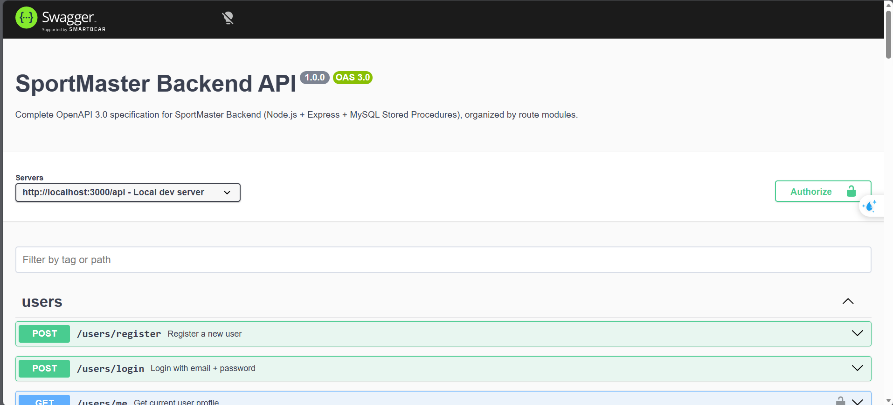

# SportMaster Backend API - Домашнее задание 3 (Homework 3)

**Студент:** Фам Хонг Линь
**Группа:** 932609
**Тема:** Client-Server Interaction & Full User Scenario

---

## 1. Выбранный пользовательский сценарий (User Scenario)
В качестве основного сценария выбрано **«Оформление заказа» (Order Checkout Flow)** в мобильном приложении SportMaster.
Пользователь просматривает каталог, добавляет товар в корзину и оформляет покупку.

**Шаги сценария (Main Flow):**
1. Пользователь открывает каталог и видит список товаров.
2. Пользователь нажимает на товар, чтобы посмотреть детали.
3. Пользователь добавляет товар в корзину (выбирает размер и цвет).
4. Пользователь переходит в корзину и проверяет заказ.
5. Пользователь подтверждает заказ (Checkout) и получает подтверждение.

*Состояния интерфейса (реализованы на клиенте через Mock/Stubs):*
- **Loading:** Скелетоны (Skeletons) при загрузке товаров.
- **Success:** Экран «Заказ успешно оформлен» с деталями заказа.
- **Error Handling:** Всплывающие сообщения (Toast) при ошибках (например, товар закончился).

---

## 2. Проектирование API (5 запросов)
API спроектировано в формате OpenAPI 3.0. Ниже описаны 5 ключевых запросов, покрывающих основной сценарий.

### Запрос 1: Получение списка товаров
- **Метод:** `GET`
- **Адрес:** `/api/products`
- **Назначение:** Отображение каталога товаров на главном экране.
- **Параметры:** `categoryId` (опционально), `page`, `pageSize`.
- **Успешный ответ (200 OK):** Возвращает массив товаров (ProductSummary).
- **Ошибки:** `500 Internal Server Error`.

### Запрос 2: Получение деталей товара
- **Метод:** `GET`
- **Адрес:** `/api/products/{productId}`
- **Назначение:** Экран детального просмотра товара (цена, размеры, описание).
- **Параметры пути:** `productId` (string, UUID/ID товара).
- **Успешный ответ (200 OK):** Возвращает объект `ProductDetail` с массивами размеров и цветов.
- **Ошибки:** `404 Not Found` (товар не найден).

### Запрос 3: Добавление товара в корзину
- **Метод:** `POST`
- **Адрес:** `/api/cart`
- **Назначение:** Добавление выбранного товара (с конкретным размером) в корзину пользователя.
- **Тело запроса:** `userId`, `productId`, `sizeId`, `quantity`, `colorId`.
- **Успешный ответ (200 OK):** Обновленный список элементов корзины.
- **Ошибки:** `400 Bad Request` (OUT_OF_STOCK - нет в наличии, SIZE_NOT_FOUND - нет такого размера).

### Запрос 4: Просмотр корзины
- **Метод:** `GET`
- **Адрес:** `/api/cart`
- **Назначение:** Отображение экрана корзины перед оформлением заказа.
- **Успешный ответ (200 OK):** Возвращает массив `CartItem` с общей суммой (`LineTotal`) и информацией о наличии.
- **Ошибки:** `401 Unauthorized` (пользователь не авторизован).

### Запрос 5: Создание заказа
- **Метод:** `POST`
- **Адрес:** `/api/orders`
- **Назначение:** Оформление заказа (списание остатков со склада).
- **Тело запроса:** `userId`, `deliveryType`, `paymentType`, `pickupId`, `shippingAddress` и др.
- **Успешный ответ (201 Created):** Возвращает объект `OrderDetail` с номером заказа и статусом.
- **Ошибки:** `400 Bad Request` (CART_EMPTY - корзина пуста, OUT_OF_STOCK - товар закончился).

---

## 3. Data Models
В спецификации OpenAPI описаны следующие модели:
- **ProductSummary / ProductDetail:** Информация о товаре (ID, Name, SKU, Price, Discount, NewPrice, Brand, Category, Sizes, Colors, ImageUrl).
- **CartItem:** Элемент корзины (ProductID, SizeID, Quantity, Price, LineTotal, IsOverStock).
- **OrderDetail:** Детали заказа (ID, OrderNumber, Status, TotalAmount, DeliveryType, PaymentType, items).
- **User:** Данные пользователя (UserID, FullName, Email, BonusPoints).

---

## 4. Errors
В ходе взаимодействия клиента и сервера предусмотрены следующие основные ошибки:
- **400 Bad Request:** `OUT_OF_STOCK` (товар закончился на складе при добавлении или оформлении), `CART_EMPTY` (попытка оформить пустую корзину).
- **401 Unauthorized:** Отсутствует или истек JWT-токен.
- **404 Not Found:** Запрашиваемый товар или заказ не существует.

---
## 5. How to Run (Dockerized) / Запуск и просмотр (Docker)
The server and Swagger UI are fully dockerized to ensure a consistent environment. 

### Prerequisites / Предварительные требования
- Docker Desktop installed and running. A local MySQL database running on your machine.

### Setup Instructions / Инструкция по запуску
1. Ensure your `.env` file is configured to connect to your local MySQL. 
**Important:** The database host must be set to `host.docker.internal`.
DB_HOST=host.docker.internal
2. **Build and start the Docker container:**
docker-compose up -d --build
3. **Check the logs to ensure the database connection is successful:** docker logs sportmaster_api\
**Accessing the Swagger UI**
Since port 3000 might be occupied by other local services, we mapped the Docker container to port 3001 on your host machine. Open your browser and navigate to:
docker logs sportmaster_api
**Swagger UI Screenshot**

